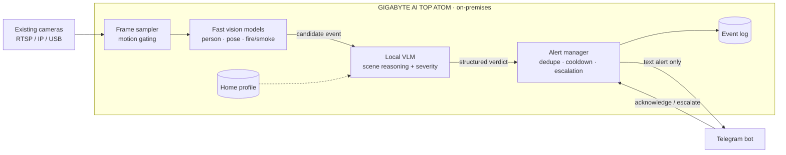

# Sentry

**Local AI that watches over your home.** Sentry turns the cameras you already own into an emergency-detection system. It spots falls, fires, leaks and dangerous situations for children, then sends the home's admin a Telegram message describing what is happening. All video analysis runs on-premises on a GIGABYTE AI TOP ATOM. No video or images ever leave the house, only a short text alert.

> Built for the **ACE 2026 · DGX Spark Mini Hackathon** — *Local AI, Real Problems*.
>
> **Status:** in active development during the hackathon. This README describes the target design. See [Roadmap](#roadmap) for what is built so far.

---

## The problem

Families are busier than ever, so more and more homes rely on CCTV to keep an eye on elderly parents, young children and pets while no one is around. But a camera only records. It doesn't *understand* what it sees:

- **Nobody watches the feed live.** Footage is usually reviewed *after* something has gone wrong.
- **Basic motion alerts are noise.** A curtain moving or a cat walking past triggers the same notification as a real emergency, so people learn to ignore them.
- **Minutes matter.** An elderly person who falls and cannot get up, a kitchen fire, or a burst pipe gets far worse with every minute nobody notices.
- **Cloud "smart camera" AI means streaming your home to someone else's servers.** That includes bedrooms, bathrooms and footage of children, and it comes with a monthly subscription.

**Who it's for:** multi-generational homes, families with young children, and care homes or assisted-living facilities, where one local AI box can cover many existing cameras.

## What Sentry does

Sentry connects to existing IP/RTSP or USB cameras, works out what is happening in each scene, and only sends an alert when something needs attention.

| Who / what   | Emergencies Sentry looks for                                                           | Scope   |
| ------------ | -------------------------------------------------------------------------------------- | ------- |
| 👵 Elderly    | Falls, and a person lying on the floor without moving for a prolonged period          | MVP     |
| 🏠 Home       | Fire and smoke                                                                         | MVP     |
| 🏠 Home       | Water leaks and flooding                                                               | Stretch |
| 🧒 Children   | Climbing furniture or windows, getting close to hazards (stove, balcony, pool)         | Stretch |
| 🐾 Pets       | Pet in distress or in a dangerous area                                                 | Stretch |

When Sentry confirms an emergency, it sends the admin a **text-only** Telegram message. There is no footage and no images, just:

- **what happened, where, and how serious it is**, in plain language,
- **action buttons** so the admin can respond straight from the chat.

```text
🚨 FALL DETECTED · Living room · Severity: HIGH
An elderly person appears to have fallen beside the sofa and has not
moved for about 20 seconds.
[ ✅ They're OK ]   [ 🔔 Escalate ]
```

**Escalate**, or no acknowledgement within a set timeout, sends the alert to the next contact on the list. Sentry does **not** contact emergency services itself.

## How it works

Sentry is a **multi-model pipeline**, not a chatbot. Cheap, fast vision models screen every sampled frame. A local vision-language model (VLM) is called only when something looks wrong, to confirm the event, judge how severe it is and explain it.



1. **Capture.** Frames are pulled from each camera stream and sampled at a low rate (about 1 fps). Motion gating skips frames where nothing has changed.
2. **Screen.** Lightweight computer-vision models run on each sampled frame: person detection and pose estimation for falls, plus fire/smoke detection. They are chosen to be light enough to cover several cameras at once.
3. **Reason.** When a screen fires, the frames around it go to the local VLM on the ATOM, along with a short **home profile** (for example, *"Grandma uses a walker and naps on the living-room sofa after lunch"*). The VLM answers the questions a detector can't, such as:
   - *"Is this person lying on the floor or on a bed?"*
   - *"Is this a fire or the stove's normal flame?"*
   - *"Is the child near the open window?"*

   It can ask for a few more seconds of footage before it decides. It returns a structured verdict:

   ```json
   {
     "event": "fall",
     "severity": "high",
     "confidence": 0.91,
     "location": "living room",
     "summary": "Elderly person on the floor beside the sofa, not moving."
   }
   ```

4. **Act.** The alert manager removes duplicate alerts, applies a cooldown, sends the Telegram alert, tracks whether anyone acknowledges it, and escalates if nobody responds. Rejected candidates are logged too, which lets us measure false alarms.

**Why two stages?** Running a VLM on every frame from every camera, 24/7, would waste compute and add latency. A VLM is also much better than a detector at telling a real emergency from an everyday look-alike, like someone lying on the sofa or bending to pick something up. Screening first and reasoning second keeps Sentry fast and cuts down false alarms.

## Why it has to run locally

The hackathon asks *"would this run the same without the ATOM?"* For Sentry, it would not:

- **Privacy by design.** Home cameras capture the most private spaces people have: bedrooms, children, elderly parents in vulnerable moments. With Sentry, video is analysed only on the ATOM and is never uploaded. No live footage, clips or snapshots are sent anywhere. The only thing that leaves the house is a short text alert to the admin's Telegram chat, such as *"Fall detected in the living room"*. Cloud cameras upload footage around the clock, so this cuts what reaches third parties to a minimum, in line with the data-minimisation principle of Malaysia's PDPA 2010.
- **Continuous analysis is only affordable locally.** Four cameras at 1 fps produce **345,600 frames a day**. Even after gating, sending candidates to a cloud VLM would cost money per call and use upstream bandwidth all the time. On the ATOM, the running cost is effectively the electricity.
- **Why the ATOM, not a Pi or a laptop.** The ATOM has 128 GB of unified memory. That's enough to keep the VLM, the detection and pose models, and several camera streams loaded at the same time. A small edge device can run a detector but not a capable VLM. A laptop can't stay on 24/7 as a home appliance.
- **Latency.** Inference happens on the same LAN as the cameras, with no upload round-trip.
- **Uses the cameras people already own.** There are no new cameras to buy and no cloud subscription. One local AI box serves the whole home.

> **Honest limitation:** detection keeps running if the internet drops, but Telegram delivery needs a connection. During an outage, events are logged locally and the alert is retried. A local alarm (speaker or LAN page) is on the roadmap.

## Tech stack

| Layer             | Choice                                                                      |
| ----------------- | --------------------------------------------------------------------------- |
| Hardware          | GIGABYTE AI TOP ATOM (NVIDIA DGX Spark platform, ARM64)                     |
| LLM / VLM serving | vLLM: the OpenAI-compatible endpoint already configured on the ATOM          |
| Computer vision   | OpenCV for stream capture, plus lightweight person/pose and fire/smoke models |
| Alerting          | Telegram Bot API (long polling, so no public webhook is needed)             |
| Language          | Python                                                                      |

> **Model notes**
> - The workshop's baseline model is NVIDIA Nemotron 3.5 Lightning. The exact served model ID, and whether it accepts **image input**, is still to be confirmed with the organisers. Check `/v1/models` (below) and set `LLM_MODEL` in `.env`.
> - If the served model is text-only, the Reason step falls back to sending the detector outputs as structured text: labels, boxes, pose keypoints and timings. We will not start a second inference service to get a VLM without organiser approval.
> - Computer-vision model weights are used only after organiser approval. They are stored under `models/` so nothing downloads at runtime.

## Getting started

> Setup and run steps describe the target layout. They will work once the corresponding files are committed (see [Roadmap](#roadmap)).
>
> Run Sentry on your team's assigned ATOM, using the inference service that is already running there. Do not start a second vLLM process or download extra models without approval from the organisers.

### Prerequisites

- Access to your team's assigned ATOM, via NVIDIA Sync → Terminal / VS Code
- Python 3.10+
- A Telegram bot token from [@BotFather](https://t.me/BotFather). Every recipient must send the bot a message first; then read each `chat.id` from `https://api.telegram.org/bot<token>/getUpdates`.
- At least one camera source: an RTSP URL, a USB webcam, or a recorded video file for demos

The ATOM is ARM64, so install aarch64-compatible builds of any CV libraries. The vLLM service already uses most of the shared GPU memory, so keep CV models small and check headroom with `nvidia-smi` first.

### Setup

```bash
git clone <this-repo-url> sentry
cd sentry
python3 -m venv .venv && source .venv/bin/activate
pip install -r requirements.txt
cp .env.example .env   # then fill in the values below
```

### Configuration (`.env`)

```dotenv
# Local inference endpoint on the ATOM (OpenAI-compatible)
LLM_BASE_URL=http://localhost:8000/v1
LLM_MODEL=<served-model-id>
LLM_API_KEY=                     # leave blank if the endpoint has no key

# Telegram
TELEGRAM_BOT_TOKEN=<your-bot-token>
TELEGRAM_CHAT_ID=<primary-chat-id>
TELEGRAM_ESCALATION_CHAT_IDS=<id2>,<id3>   # notified in order if unacknowledged
ESCALATION_TIMEOUT_SECONDS=120

# Cameras: comma-separated "name=source" pairs (RTSP URL, device index, or video file).
# RTSP URLs often contain the camera's username/password, so keep them only in .env.
CAMERAS=living_room=rtsp://<camera-ip>/stream,kitchen=0,demo=samples/fall_demo.mp4

# Local data retention for the event log on the ATOM
RETENTION_DAYS=7
```

Never commit `.env`, event logs or recordings. Add them to `.gitignore`.

### Verify the local model

```bash
nvidia-smi                                                   # GPU is visible
curl -s http://localhost:8000/v1/models | python3 -m json.tool   # endpoint is up; note the model "id"
```

Use the host and port the organisers gave you if they differ from vLLM's default `localhost:8000`. If the endpoint requires a key, add `-H "Authorization: Bearer <key>"`.

### Run

```bash
python3 -m sentry
```

## Demo

Our 5-minute demo runs the complete workflow end to end on the ATOM:

1. Sentry watches a staged scene, either from a live camera or a recorded clip.
2. **True alarm:** a team member acts out a fall. The fast models flag it, the local VLM confirms it, and a text alert describing the fall arrives on the admin's phone through Telegram.
3. **False alarm caught:** a team member lies down on a couch or bends to pick something up. The detector flags it, the VLM rejects it, and no alert is sent. The rejected verdict appears in the event log.
4. **Fire:** a synthetic or approved stock clip is played as a camera source. We don't stage real fires.
5. We tap **Escalate**, show the alert reaching the second contact, then tap **They're OK**.
6. Throughout, `nvidia-smi` and the vLLM request log on the ATOM are on screen, to prove inference is local.

All demo footage is staged by the team or synthetic. Any third-party clips are used only with organiser approval and a compatible licence. No real household footage is used.

## Results

*To be filled in from measurements on the ATOM.*

| Metric                                         | Value |
| ---------------------------------------------- | ----- |
| End-to-end latency (event confirmed → Telegram) | _TBD_ |
| VLM latency per verdict                        | _TBD_ |
| Cameras handled at the same time               | _TBD_ |
| Staged test clips: true alarms caught           | _TBD_ |
| Staged test clips: false alarms rejected by VLM | _TBD_ |

## How Sentry maps to the judging criteria

| Criterion                | Weight | Where to look                                                                                       |
| ------------------------ | :----: | --------------------------------------------------------------------------------------------------- |
| AI capability            | 25%    | [How it works](#how-it-works): CV screening → VLM reasoning with home context → alerting and escalation |
| Local AI on the ATOM     | 25%    | [Why it has to run locally](#why-it-has-to-run-locally); demo step 6                                |
| Impact & feasibility     | 20%    | [The problem](#the-problem): reuses existing cameras, no subscription, privacy-preserving           |
| Technical implementation | 15%    | [Demo](#demo) and [Results](#results)                                                               |
| Pitch & demo             | 15%    | Live demo of a true alarm, a rejected false alarm and escalation                                    |

## Roadmap

- [ ] Camera ingestion and frame sampling
- [ ] Fall detection (person + pose) and fire/smoke screening
- [ ] VLM verification with structured verdicts and home profile
- [ ] Text-only Telegram alerts with action buttons
- [ ] Acknowledgement tracking and escalation
- [ ] Event log with rejected candidates
- [ ] Water leak and child-safety scenarios
- [ ] Local alarm when the internet is down
- [ ] Local event-log dashboard (LAN-only, password-protected)
- [ ] Audio cues (calls for help, smoke alarms) via local speech-to-text
- [ ] Per-camera danger zones (stove, balcony, pool) and privacy zones

## Limitations & responsible use

- Sentry **supports** human caregivers. It is **not** a certified safety or medical device, and it does not replace smoke detectors, emergency services or professional care.
- Like any vision system, it can miss events (poor lighting, the person outside the camera's view) and can raise false alarms. Alerts describe what Sentry saw, so the admin can check in (for example by calling home or opening their existing CCTV app) and make the final call.
- **Consent.** Get consent from the adults being monitored, including elderly parents, and respect their right to refuse. Tell carers, domestic helpers and regular visitors. Don't put cameras in bathrooms.
- **Data handling.** Sentry does not record continuously, and no footage or images are sent off the ATOM. Only event verdicts are kept in the local event log, and they are deleted after `RETENTION_DAYS`. Text alerts already delivered to Telegram must be deleted there separately.
- **Access control.** The bot sends alerts to, and accepts button presses from, an allow-list of chat IDs only. Use a private chat, or a small group with only the people who should see these alerts.

## Team

| Name | Role |
| ---- | ---- |
| _TBD_ | _ATOM / AI pipeline_ |
| _TBD_ | _Computer vision_ |
| _TBD_ | _Telegram & alerting_ |
| _TBD_ | _Frontend / dashboard_ |
| _TBD_ | _Testing, docs & pitch_ |

## Acknowledgements

Built at **ACE 2026 · DGX Spark Mini Hackathon** on a GIGABYTE AI TOP ATOM, with thanks to NVIDIA, GIGABYTE and EMARQUE for the hardware, local inference setup and support.
