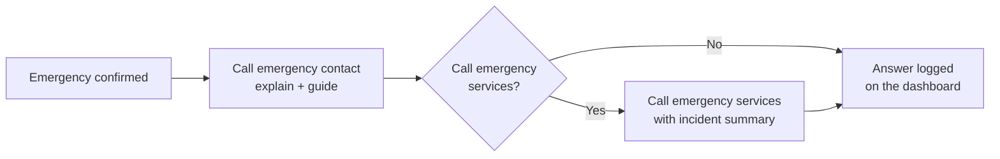
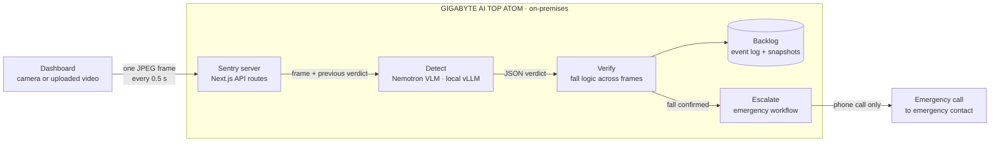

# Sentry

**Sentry is a human-in-the-loop incident-response agent that turns your existing cameras into a local detect, verify and escalate pipeline.**

- **Detect.** NVIDIA Nemotron, a vision-language model, analyses the camera feed frame by frame for emergencies such as an elderly person falling.
- **Verify.** Sentry confirms an emergency only when several frames over a few seconds agree, so one bad frame doesn't raise a false alarm.
- **Escalate.** As soon as a fall is confirmed, Sentry phones the household's emergency contact. A fall is urgent, so there is no text alert that might sit unread.

People stay in control of every serious decision: Sentry only calls emergency services when the emergency contact says yes. All video analysis runs on-premises on a GIGABYTE AI TOP ATOM. No video or images ever leave the house, only a phone call.

> Built for the **ACE 2026 · DGX Spark Mini Hackathon** — *Local AI, Real Problems*.
>
> **Status:** in active development during the hackathon. The detect and verify stages are built: the dashboard and frame-by-frame fall detection. The escalate stage (the emergency call) is next. See [Roadmap](#roadmap).

---

## The problem

Families are busier than ever, so more and more homes rely on CCTV to keep an eye on elderly parents, young children and pets while no one is around. But a camera only records. It doesn't *understand* what it sees:

- **Nobody watches the feed live.** Footage is usually reviewed *after* something has gone wrong.
- **Basic motion alerts are noise.** A curtain moving or a cat walking past triggers the same notification as a real emergency, so people learn to ignore them.
- **Minutes matter.** An elderly person who falls and cannot get up, a kitchen fire, or a burst pipe gets far worse with every minute nobody notices.
- **Cloud "smart camera" AI means streaming your home to someone else's servers.** That includes bedrooms, bathrooms and footage of children, and it comes with a monthly subscription.

**Who it's for:** multi-generational homes, families with young children, and care homes or assisted-living facilities, where one local AI box can cover many existing cameras.

## What Sentry does

Sentry connects to existing IP/RTSP or USB cameras, works out what is happening in each scene, and only calls someone when something needs attention.

Every analysed frame is checked by Nemotron for any of these emergencies (the `type` in its answer):

| Who / what   | Emergencies Sentry looks for                                                           | `type`         |
| ------------ | -------------------------------------------------------------------------------------- | -------------- |
| 👵 Elderly    | Falls: a person on the floor after a fall or collapse, or in the middle of falling     | `fall`         |
| 👵 Elderly    | Medical distress without a fall: clutching the chest, seizure, choking, bleeding, unresponsive | `medical` |
| 🏠 Home       | Fire and smoke where they shouldn't be                                                 | `fire_smoke`   |
| 🏠 Home       | Water leaks, burst pipes and flooding                                                  | `water_leak`   |
| 🧒 Children   | A child at a hazard: window, balcony or railing, hot stove, pool, knives or medicine    | `child_danger` |
| 🔒 Security   | Break-ins and violence                                                                 | `intruder`     |
| ❗ Anything else | Any other situation that clearly needs urgent help                                  | `other`        |

Normal life is not an emergency: sleeping, lying on the sofa, sitting on the floor calmly, cooking, a lit candle or fireplace, children playing safely, pets.

### Automatic emergency call

When Sentry confirms an emergency, it **phones the emergency contact straight away**. An emergency is urgent, so Sentry doesn't send a text message that might sit unread. The emergency contact is a person the household chose, such as a family member or neighbour. Before dialling, Nemotron on the ATOM writes the call from what it saw (the emergency type, its description of the frame, the room and the time). On the call, Sentry:

1. **explains what happened**: what was detected, where, and when;
2. **tells the contact what to do right now**, choosing only from the fixed checklist for that emergency type (a fall, a fire, a water leak, ...) so it never invents advice;
3. **asks: "Do you want me to call emergency services?"** If the contact says yes (or presses 1), Sentry calls emergency services and reads out an incident summary.



If the contact says no, Sentry makes no second call. It logs the answer on the dashboard.

**Human in the loop.** Sentry only calls public emergency services (999) when the emergency contact confirms it on the call. It never does so on its own.

## How it works

Sentry is an **incident-response agent**, not a chatbot. It runs a three-stage vision-language pipeline on the ATOM: **detect**, **verify** and **escalate**. **NVIDIA Nemotron** describes each frame and detects whether someone has fallen. Sentry's fall logic verifies a fall only when several frames over a few seconds agree. Then the emergency workflow escalates to the people who can help.



1. **Sample.** The dashboard plays the camera feed or an uploaded video and grabs a frame every 0.5 s of video. Frames are sent one at a time: the next frame goes only after Nemotron has answered, so the model is never flooded.
2. **Detect.** Each frame goes to Nemotron on the ATOM with a short instruction, plus the previous frame's verdict for context. Nemotron answers questions a simple motion or object detector can't, such as *"Is this person on the floor, or on a bed or sofa?"* and *"Did they fall, or are they lying down on purpose?"* Guided decoding makes it return a structured verdict:

   ```json
   {
     "person_visible": true,
     "posture": "lying",
     "on_floor": true,
     "fall_detected": true,
     "confidence": 0.91,
     "description": "Elderly person lying on the floor beside the sofa."
   }
   ```

3. **Verify.** A single frame can be wrong, so Sentry confirms a fall only when:
   - at least 2 frames, at least 2 s apart, show a fall;
   - and no clear "sitting up" or "standing" frame comes in between.

   If the video ends right after a fall, Sentry keeps checking the frozen last frame for a few seconds so the fall can still be confirmed.
4. **Escalate.** A confirmed fall raises a **FALL DETECTED** alert on the dashboard with a snapshot, adds an entry to the Backlog and starts the emergency workflow, which phones the emergency contact straight away. Every frame's verdict is logged too, so false alarms are easy to spot.

## Why it has to run locally

The hackathon asks *"would this run the same without the ATOM?"* For Sentry, it would not:

- **Privacy by design.** Home cameras capture the most private spaces people have: bedrooms, children, elderly parents in vulnerable moments. With Sentry, video is analysed only on the ATOM and is never uploaded. No live footage, clips or snapshots are sent anywhere. The only thing that leaves the house is the emergency phone call, which speaks a short message such as *"A fall was detected in the living room"*. Cloud cameras upload footage around the clock, so this cuts what reaches third parties to a minimum, in line with the data-minimisation principle of Malaysia's PDPA 2010.
- **Continuous analysis is only affordable locally.** Four cameras analysed at 2 frames a second produce **691,200 frames a day**. Sending each one to a cloud VLM would cost money per call and use upstream bandwidth all the time. On the ATOM, the running cost is effectively the electricity.
- **Why the ATOM, not a Pi or a laptop.** The ATOM has 128 GB of unified memory, enough to run a capable vision-language model like Nemotron locally and analyse frames continuously. A small edge device can't run a VLM, and a laptop can't stay on 24/7 as a home appliance.
- **Latency.** Inference happens on the same LAN as the cameras, with no upload round-trip.
- **Uses the cameras people already own.** There are no new cameras to buy and no cloud subscription. One local AI box serves the whole home.

> **Honest limitation:** detection keeps running if the internet drops, but the emergency call needs a connection. During an outage, events are logged locally and the call is retried. A local alarm (speaker or LAN page) is on the roadmap.

## Tech stack

| Layer             | Choice                                                                      |
| ----------------- | --------------------------------------------------------------------------- |
| Hardware              | GIGABYTE AI TOP ATOM (NVIDIA DGX Spark platform, ARM64)                          |
| Vision-language model | NVIDIA Nemotron, served by the vLLM endpoint already configured on the ATOM (OpenAI-compatible) |
| App                   | Next.js 16 (App Router), TypeScript: camera dashboard and API routes             |
| Frame capture         | In the dashboard: `<video>` + canvas, for each camera's clip or a webcam         |
| Storage               | Local event log (JSON lines) and fall snapshots in `data/` on the ATOM           |
| Emergency calls       | `sentry_calls` (Python, Flask): Twilio voice call, script written by Nemotron within fixed safety rails; started locally when an emergency is confirmed (see [CALLS.md](CALLS.md)) |

> **Model notes**
> - Frame-by-frame analysis needs a model that accepts **image input**. On the ACE 2026 ATOM that is **Nemotron 3 Nano Omni** (`omni`, port 9001). The briefing's baseline, Nemotron 3.5 Lightning (`lightning`, port 9000), and Nemotron 3 Nano (`nano`, port 9006) are text-only and reject images. Set `LLM_BASE_URL` and `LLM_MODEL=omni` in `.env.local`.
> - Measured on our ATOM: about 1.1–1.6 s per frame once warm. The first request after idle can take about 20 s, so send one warm-up frame before the demo.
> - Sentry only uses the existing endpoint and never starts a second inference service.
> - For reasoning-capable Nemotron models, Sentry asks the model to answer without thinking (`LLM_DISABLE_THINKING=true`) to keep each frame fast.

## Getting started

> Run Sentry on your team's assigned ATOM, using the inference service that is already running there. Don't start a second vLLM process or download extra models without approval from the organisers.

### Prerequisites

- Access to your team's assigned ATOM, via NVIDIA Sync → Terminal / VS Code
- Node.js 20.9 or newer
- A staged or synthetic video clip of a fall for the demo (see [demo.md](demo.md))

### Setup

```bash
git clone <this-repo-url> sentry
cd sentry
npm install
python3 -m venv .venv && .venv/bin/pip install -r requirements-calls.txt   # the call service
cp .env.example .env         # then fill in the values (see the comments in the file)
```

The most important settings in `.env`:

| Variable | Default | What it does |
| -------- | ------- | ------------ |
| `LLM_BASE_URL` | `http://localhost:9001/v1` | The ATOM's local inference endpoint |
| `LLM_MODEL` | `omni` | Nemotron model ID |
| `ANALYSIS_INTERVAL_S` | `0.5` | Seconds between analysed frames |
| `FALL_CONFIRM_FRAMES` / `FALL_CONFIRM_SECONDS` | `2` / `2` | How many fall frames, over how long, confirm a fall |
| `FALL_MIN_CONFIDENCE` | `0.5` | Ignore fall verdicts below this confidence |
| `EMERGENCY_CALLS` | `off` | `on` = call the emergency contact when a fall is confirmed, `simulate` = print the call script only |
| `EMERGENCY_CALL_DELAY_S` | `0` | Wait before calling; **Mark OK** on the dashboard in that time cancels the call |
| `EMERGENCY_CONTACT_PHONE`, `APPROVED_DEMO_NUMBERS`, `TWILIO_*`, `PUBLIC_BASE_URL` | – | Call service settings, see [CALLS.md](CALLS.md) |

Never commit `.env`, `.env.local`, `data/` (event log and snapshots) or `public/videos/` clips. All are in `.gitignore`.

### Camera clips

Put one clip per camera in `public/videos/` (names in [public/videos/README.md](public/videos/README.md), cameras and map in `lib/client/cameras.ts`), or press **Upload video** / drop a file on the screen to play it on the current camera. A clip waits on its first frame until you press **Space**, plays once, then stays on its last frame. Sentry keeps analysing that last frame like a live camera, so a fall at the very end is still confirmed.

### Verify the local model

```bash
nvidia-smi                                                  # GPU is visible
curl -s http://localhost:8000/v1/models | python3 -m json.tool  # endpoint is up; note the model "id"
```

Use the host and port the organisers gave you if they differ from vLLM's default `localhost:8000`. If the endpoint requires a key, set `LLM_API_KEY` and add `-H "Authorization: Bearer <key>"` to the curl command.

### Run

```bash
npm run build && npm start      # or `npm run dev` while developing
```

Open **http://localhost:3000**. When you connect through NVIDIA Sync / VS Code, forward port 3000 to your laptop and open it on `localhost`. The browser only allows the webcam camera (CAM 5) on `localhost` or HTTPS. The AI log says **Nemotron offline** if the endpoint doesn't answer.

Restart the server after changing `.env`, `.env.local` or anything in `lib/server/`.

For real emergency calls, also run the call service and an HTTPS tunnel to it on the same machine as the dashboard, and set `PUBLIC_BASE_URL` to the tunnel's address:

```bash
npm run calls:serve      # Twilio callback server on 127.0.0.1:5050
ngrok http 5050          # copy the https URL into PUBLIC_BASE_URL in .env, then restart both servers
```

Before each call Sentry checks that both answer; if not, it logs why in the AI log and doesn't place a broken call. `npm run calls:history` shows what happened on each call.

### Running the app on a laptop against the ATOM's model

Node.js isn't installed on the ATOM, so you can run Sentry on your laptop and forward the model port over SSH. Inference still runs on the ATOM:

```bash
ssh -N -L 9001:127.0.0.1:9001 DGX-Spark   # the SSH alias NVIDIA Sync creates; keep it running
npm run dev                               # .env.local: LLM_BASE_URL=http://localhost:9001/v1, LLM_MODEL=omni
```

Two synthetic test clips are in `samples/`:
- `fall.mp4`: an elderly person falls and stays on the floor. It should raise an alert.
- `sofa.mp4`: a person lies down on the sofa on purpose. It should not.

### Working without the ATOM

```bash
npm run mock                                                   # fake endpoint on :8000
LLM_BASE_URL=http://localhost:8000/v1 npm run dev
```

The mock ignores the image: it answers "standing" for the first few frames of each video, then "fallen". Use it only to work on the dashboard, never for the real demo.

### Tests and checks

```bash
npm test          # fall logic and verdict parsing
npm run lint
npm run typecheck
.venv/bin/python -m unittest discover -s tests -v   # call service
```

### Project layout

```text
app/                    Next.js App Router: the dashboard page and the API routes
  api/sessions/         start/stop an analysis session; POST each frame to …/[id]/frames
  api/logs/             AI log entries (GET), and POST to log LLM output from other components
  api/status/           model health, settings and the active alert
components/             Camera screen, floor-plan map with CAM buttons, AI log
lib/client/cameras.ts   cameras, rooms and map layout
lib/client/             useFrameAnalyzer: samples frames from the camera on screen and sends them
lib/server/nemotron.ts  calls Nemotron on the local vLLM endpoint
lib/server/fall.ts      turns per-frame verdicts into fall events
lib/server/workflow.ts  emergency workflow: starts the sentry_calls call when a fall is confirmed
sentry_calls/           Twilio call service (explain, first-aid checklist, ask to escalate)
public/videos/          camera clips (not committed)
scripts/mock-nemotron.mjs  fake endpoint for development
tests/                  unit tests (vitest, and unittest for the call service)
```

## Demo

Our 5-minute demo shows an elderly fall handled end to end on the ATOM. **See [demo.md](demo.md) for the full script.**

1. The Sentry dashboard shows the home's camera feed.
2. We upload a video of an elderly person falling, which plays as a camera source.
3. Nemotron confirms the fall. Sentry calls the emergency contact, explains what happened and what to do, then asks whether to call emergency services.

During the demo, the "emergency contact" and "emergency services" are both teammates' phones. No real emergency number is ever dialled. All demo footage is staged by the team or synthetic. Any third-party clips are used only with organiser approval and a compatible licence. No real household footage is used.

## Results

*To be filled in from measurements on the ATOM.*

| Metric                                         | Value |
| ---------------------------------------------- | ----- |
| End-to-end latency (event confirmed → phone rings) | _TBD_ |
| VLM latency per verdict                        | _TBD_ |
| Cameras handled at the same time               | _TBD_ |
| Staged test clips: true alarms caught           | _TBD_ |
| Staged test clips: false alarms rejected by VLM | _TBD_ |

## How Sentry maps to the judging criteria

| Criterion                | Weight | Where to look                                                                                       |
| ------------------------ | :----: | --------------------------------------------------------------------------------------------------- |
| AI capability            | 25%    | [How it works](#how-it-works): detect (frame-by-frame Nemotron VLM analysis) → verify (multi-frame fall confirmation) → escalate (an immediate call to the emergency contact), with a human in the loop |
| Local AI on the ATOM     | 25%    | [Why it has to run locally](#why-it-has-to-run-locally); [demo.md](demo.md) step 6                    |
| Impact & feasibility     | 20%    | [The problem](#the-problem): reuses existing cameras, no subscription, privacy-preserving           |
| Technical implementation | 15%    | [Demo](#demo) and [Results](#results)                                                               |
| Pitch & demo             | 15%    | [demo.md](demo.md): live elderly-fall scenario from dashboard to emergency call                     |

## Roadmap

- [x] Camera dashboard with floor-plan map, CAM buttons, video upload and AI log
- [x] Frame-by-frame fall detection with Nemotron and structured verdicts
- [x] Fall confirmation across frames, with every verdict and false alarm logged
- [x] Automatic emergency call to the emergency contact as soon as a fall is confirmed
- [x] Call script: explain, guide from the first-aid checklist, offer to call emergency services (a teammate in the demo)
- [ ] RTSP / IP camera ingestion on the ATOM (today: uploaded video or browser webcam)
- [ ] Home profile in the prompt (for example, "Grandma naps on the sofa after lunch")
- [ ] Fire/smoke, water leak and child-safety scenarios
- [ ] Local alarm when the internet is down
- [ ] Local event-log dashboard (LAN-only, password-protected)
- [ ] Audio cues (calls for help, smoke alarms) via local speech-to-text
- [ ] Per-camera danger zones (stove, balcony, pool) and privacy zones

## Limitations & responsible use

- Sentry **supports** human caregivers. It is **not** a certified safety or medical device, and it does not replace smoke detectors, emergency services or professional care.
- Like any vision system, it can miss events (poor lighting, the person outside the camera's view) and can raise false alarms. The call describes what Sentry saw, so the emergency contact can check in (for example by calling home or opening their existing CCTV app) and decide what to do.
- **Consent.** Get consent from the adults being monitored, including elderly parents, and respect their right to refuse. Tell carers, domestic helpers and regular visitors. Don't put cameras in bathrooms.
- **Data handling.** Sentry does not record continuously, and no footage or images are sent off the ATOM. Only frame verdicts and a snapshot of each confirmed fall are kept, locally in `data/` on the ATOM. Delete that folder to clear them (automatic retention is on the roadmap).
- **Emergency contact.** The emergency contact must agree to receive automatic calls. Keep their number up to date, because Sentry calls it as soon as a fall is confirmed.
- **Access control.** Sentry only calls the phone numbers set in its configuration: the emergency contact and the emergency services number.

## Team

| Name | Role |
| ---- | ---- |
| _TBD_ | _ATOM / AI pipeline_ |
| _TBD_ | _Computer vision_ |
| _TBD_ | _Emergency call & voice agent_ |
| _TBD_ | _Frontend / dashboard_ |
| _TBD_ | _Testing, docs & pitch_ |

## Acknowledgements

Built at **ACE 2026 · DGX Spark Mini Hackathon** on a GIGABYTE AI TOP ATOM, with thanks to NVIDIA, GIGABYTE and EMARQUE for the hardware, local inference setup and support.
