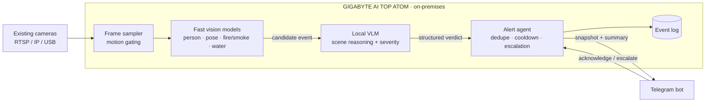

# Sentry

**Local AI that watches over your home.** Sentry turns the cameras you already own into an emergency-detection system. It spots falls, fires, leaks and dangerous situations for children, then alerts you on Telegram within seconds. Every frame is analysed on-premises on a GIGABYTE AI TOP ATOM, so no video of your home ever leaves the house.

> Built for the **ACE 2026 · DGX Spark Mini Hackathon** — *Local AI, Real Problems*.

---

## The problem

Families are busier than ever, so more and more homes rely on CCTV to keep an eye on elderly parents, young children and pets while no one is around. But a camera only records. It doesn't *understand* what it sees:

- **Nobody watches the feed live.** Footage is usually reviewed *after* something has gone wrong.
- **Basic motion alerts are noise.** A curtain moving or a cat walking past triggers the same notification as a real emergency, so people learn to ignore them.
- **Minutes matter.** An elderly person who falls and cannot get up, a kitchen fire, or a burst pipe gets far worse with every minute nobody notices.
- **Cloud "smart camera" AI means streaming your home to someone else's servers.** That includes bedrooms, bathrooms and footage of children, and it comes with a monthly subscription.

## What Sentry does

Sentry plugs into existing IP/RTSP or USB cameras, continuously understands what is happening in each scene, and only alerts when something actually needs attention.

| Who / what       | Emergencies Sentry looks for                                                         |
| ---------------- | ------------------------------------------------------------------------------------ |
| 👵 Elderly        | Falls, and a person lying on the floor without moving for a prolonged period        |
| 🏠 Home           | Fire and smoke, water leaks and flooding                                             |
| 🧒 Children       | Climbing furniture or windows, getting close to hazards (stove, balcony, pool), being left unattended |
| 🐾 Pets *(stretch)* | Pet in distress or in a dangerous area                                              |

When Sentry detects an emergency, it sends a Telegram message containing:

- a **snapshot** of the moment it was detected,
- **what happened, where, and how serious it is**, in plain language,
- **action buttons** so the family can respond straight from the chat.

```text
🚨 FALL DETECTED · Living room · Severity: HIGH
An elderly person appears to have fallen beside the sofa and has not
moved for about 20 seconds.
[ ✅ They're OK ]   [ 📞 Escalate ]
```

If nobody acknowledges the alert, Sentry re-sends it and escalates to the next emergency contact.

## How it works

Sentry is a **multi-model pipeline**, not a chatbot. Cheap, fast vision models screen every frame. A local vision-language model (VLM) is called only when something looks wrong, to confirm the event, judge how severe it is and explain it.



1. **Capture.** Frames are pulled from each camera stream and sampled at a low rate. Motion gating skips frames where nothing has changed.
2. **Screen.** Lightweight computer-vision models run on every sampled frame: person detection and pose estimation for falls, plus fire/smoke and water detection. They are fast enough to cover several cameras at once.
3. **Reason.** When a screen fires, the frames around it go to the local VLM served on the ATOM. The VLM answers questions a detector can't, such as *"Is this person lying on the floor or on a bed?"*, *"Is this a fire or the stove's normal flame?"* or *"Is the child near the open window?"* It returns a structured verdict:

   ```json
   {
     "event": "fall",
     "severity": "high",
     "confidence": 0.91,
     "location": "living room",
     "summary": "Elderly person on the floor beside the sofa, not moving."
   }
   ```

4. **Act.** The alert agent removes duplicate alerts, applies a cooldown period, picks recipients by severity, sends the Telegram alert and tracks whether anyone acknowledges it. It escalates if nobody responds.

**Why two stages?** Running a VLM on every frame from every camera, 24/7, would waste compute and add latency. A VLM is also much better than a detector at telling a real emergency from an everyday look-alike. Screening first and reasoning second keeps Sentry fast and cuts down false alarms.

## Why it has to run locally

The hackathon asks *"would this run the same without the ATOM?"* For Sentry, it would not:

- **Privacy by design.** Home cameras capture the most private spaces people have: bedrooms, bathrooms, children, elderly parents in vulnerable moments. With Sentry, raw video and frames never leave the house. The only data sent out is the alert itself (text plus one snapshot) to the family's own Telegram chat. This also makes it easier to stay in line with Malaysia's Personal Data Protection Act (PDPA).
- **Continuous analysis is only affordable locally.** Sending frames from several cameras to a cloud VLM around the clock would cost money for every API call and use a lot of bandwidth. On the ATOM, the running cost is effectively the electricity.
- **Latency.** Inference happens on the same LAN as the cameras, with no upload round-trip. That matters when someone has fallen or a fire has started.
- **Resilience.** Detection and reasoning keep running even if the internet connection is slow or drops. Events are logged locally, and alerts are queued until the connection comes back.
- **Uses the cameras people already own.** There's no new hardware to buy for every room and no cloud subscription. One local AI box serves the whole home.

## Tech stack

| Layer            | Choice                                                            |
| ---------------- | ----------------------------------------------------------------- |
| Hardware         | GIGABYTE AI TOP ATOM (NVIDIA DGX Spark platform)                  |
| LLM / VLM serving | vLLM, OpenAI-compatible endpoint pre-configured on the ATOM       |
| Computer vision  | OpenCV for stream capture, plus lightweight detection/pose models |
| Alerting         | Telegram Bot API                                                  |
| Language         | Python                                                            |

> **Model note:** The workshop's baseline model is NVIDIA Nemotron 3.5 Lightning. The exact model ID served on our ATOM is confirmed with the organisers. Set it in `.env` (see below).

## Getting started

> Run Sentry on your team's assigned ATOM, using the inference service that is already running there. Don't start a second vLLM process or download extra models without approval from the organisers.

### Prerequisites

- Access to the assigned GIGABYTE AI TOP ATOM (via NVIDIA Sync → Terminal / VS Code)
- Python 3.10+
- A Telegram bot token from [@BotFather](https://t.me/BotFather), and the chat ID that should receive alerts
- At least one camera source: an RTSP URL, a USB webcam, or a recorded video file for demos

### Setup

```bash
git clone <this-repo-url> sentry
cd sentry
python -m venv .venv && source .venv/bin/activate
pip install -r requirements.txt
cp .env.example .env   # then fill in the values below
```

### Configuration (`.env`)

```dotenv
# Local inference endpoint on the ATOM (OpenAI-compatible)
LLM_BASE_URL=http://localhost:8000/v1
LLM_MODEL=<served-model-id>

# Telegram
TELEGRAM_BOT_TOKEN=<your-bot-token>
TELEGRAM_CHAT_ID=<family-chat-id>

# Cameras: comma-separated "name=source" pairs (RTSP URL, device index, or video file)
CAMERAS=living_room=rtsp://<camera-ip>/stream,kitchen=0,demo=samples/fall_demo.mp4
```

Never commit `.env`. It holds your bot token and camera addresses.

### Verify the local model

```bash
hostname          # confirm this is your team's ATOM
nvidia-smi        # confirm the GPU is visible
curl -s "$LLM_BASE_URL/models"   # confirm the local endpoint is up and note the model ID
```

### Run

```bash
python -m sentry
```

## Demo

Our 5-minute demo runs the complete workflow end to end on the ATOM:

1. Sentry watches a staged scene (a live camera or a recorded clip).
2. A team member acts out an emergency, such as a fall.
3. The fast models flag it, and the local VLM confirms it and writes a summary.
4. A Telegram alert with a snapshot arrives on a phone in seconds.
5. We tap **Escalate** or **They're OK** and show that the event log is updated.

All demo footage is staged by the team or synthetic. No real household footage is used.

## How Sentry maps to the judging criteria

| Criterion                        | Weight | How Sentry addresses it                                                                 |
| -------------------------------- | :----: | --------------------------------------------------------------------------------------- |
| AI capability                    | 25%    | Multi-model, multimodal workflow: CV screening → VLM reasoning → agentic alerting and escalation |
| Local AI on the ATOM             | 25%    | All video inference runs on the ATOM; only the alert leaves the house (see *Why it has to run locally*) |
| Impact & feasibility             | 20%    | Real household problem; reuses existing cameras; no subscription; privacy-preserving    |
| Technical implementation         | 15%    | Working end-to-end pipeline from camera to Telegram alert                               |
| Pitch & demo                     | 15%    | Live demo of a staged emergency triggering a real alert                                 |

## Roadmap

- [ ] Camera ingestion and frame sampling
- [ ] Fall detection (person + pose) and fire/smoke screening
- [ ] VLM verification with structured verdicts
- [ ] Telegram alerts with snapshot and action buttons
- [ ] Acknowledgement tracking and escalation
- [ ] Water leak and child-safety scenarios
- [ ] Local event-log dashboard
- [ ] Audio cues (calls for help, smoke alarms) via local speech-to-text
- [ ] Per-camera "danger zones" (stove, balcony, pool)

## Limitations & responsible use

- Sentry **supports** human caregivers. It is **not** a certified safety or medical device, and it does not replace smoke detectors, emergency services or professional care.
- Like any vision system, it can miss events (for example in poor lighting or when the person is outside the camera's view) and can raise false alarms. Alerts always come with a snapshot, so a human makes the final call.
- Only point Sentry at spaces you have the right to monitor, and tell the people living there about it.

## Team

| Name | Role |
| ---- | ---- |
| _TBD_ | _ATOM / AI pipeline_ |
| _TBD_ | _Computer vision_ |
| _TBD_ | _Telegram & alerting_ |
| _TBD_ | _Frontend / dashboard_ |
| _TBD_ | _Testing, docs & pitch_ |

## Acknowledgements

Built at **ACE 2026 · DGX Spark Mini Hackathon** on a GIGABYTE AI TOP ATOM, with thanks to NVIDIA, GIGABYTE and EMARQUE for the hardware, local inference setup and support.
